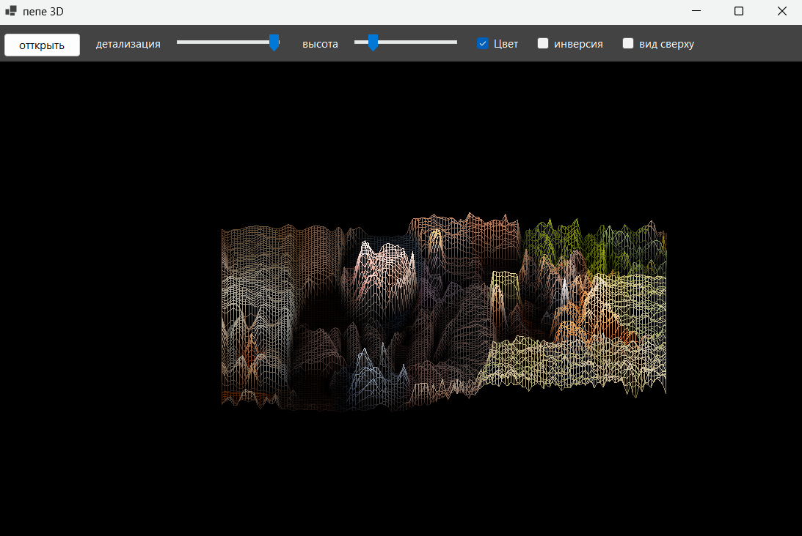
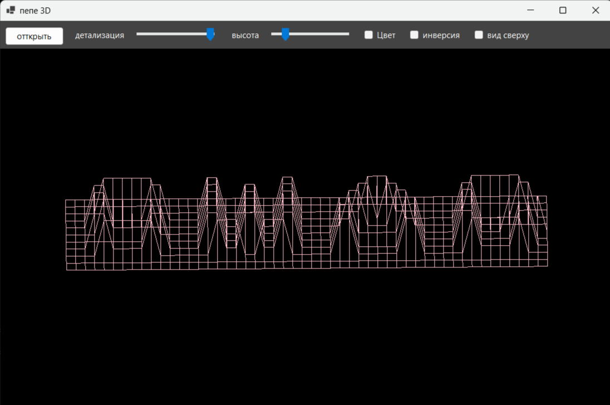
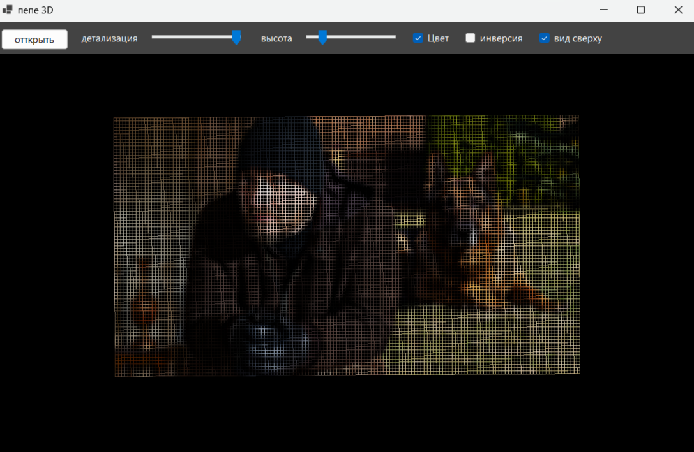

# FdF — каркасная 3D-модель карты высот

[](https://github.com/alena0615/3Dshtuchka/actions/workflows/ci.yml)



## Описание

Программа на C# (WinForms) читает карту высот в формате `.fdf` и рисует каркасную модель поверхности в изометрической проекции. Сделано по мотивам проекта FdF (Fil de Fer) школы 42.

Кроме `.fdf` можно открыть обычную картинку (png, jpg, bmp). Она сжимается до сетки, а высотой каждой клетки становится яркость пикселя: `0.299·R + 0.587·G + 0.114·B`.

Точка карты `(x, y, z)` переводится на экран по формулам изометрии:

```
x' = (x − y) · cos 30°
y' = (x + y) · sin 30° − z · z_scale
X = x' · scale + offset_x,   Y = y' · scale + offset_y
```

Высота вычитается, потому что ось Y экрана направлена вниз. `scale` и смещение подбираются так, чтобы карта занимала 90 % окна и стояла по центру. При изменении размера окна карта подгоняется заново. Каркас строится из отрезков от каждой точки к соседу справа и снизу, поэтому каждое ребро рисуется один раз.

Карта `.fdf` без цвета:



Вид сверху (галочка «вид сверху»):



## Установка и запуск

Проще всего скачать готовый `pepe3D.exe` на странице [Releases](https://github.com/alena0615/3Dshtuchka/releases) и запустить. Устанавливать .NET не нужно. Там же лежит `maps.zip` с тестовыми картами.

Запуск из исходников: нужны Windows и [.NET 8 SDK](https://dotnet.microsoft.com/download/dotnet/8.0). Других зависимостей нет: пакеты для тестов (xUnit) скачиваются автоматически.

```
git clone https://github.com/alena0615/3Dshtuchka.git
cd 3Dshtuchka
dotnet run
```

Откроется пустое окно. Карту или картинку выбирают кнопкой «открыть». Тестовые карты лежат в папке `maps/`.

## Управление

| Клавиша / элемент | Действие |
|---|---|
| кнопка «открыть» | открыть карту `.fdf` или картинку (png, jpg, jpeg, bmp) |
| левая кнопка мыши + движение | влево-вправо — поворот, вверх-вниз — наклон (можно заглянуть снизу) |
| колесо мыши | масштаб; точка под курсором остаётся на месте |
| стрелки | сдвиг изображения |
| ползунок «детализация» | сколько клеток в ширину у картинки (20–150) |
| ползунок «высота» | высота рельефа (`z_scale`) |
| галочка «Цвет» | цвета из файла или картинки / все линии розовые |
| галочка «инверсия» | для картинки: светлое вниз, тёмное вверх (у светлых картинок включается сама) |
| галочка «вид сверху» | параллельная проекция `X = x, Y = y` без учёта высоты |
| Esc | выход |

Ползунки и галочки не сбрасывают масштаб и сдвиг.

## Формат карты

Файл текстовый. Строка файла — ряд точек (координата y), позиция значения в строке — координата x, само значение — высота z.

- Значения разделяются одним или несколькими пробелами.
- Высота — целое число, можно отрицательное.
- Во всех строках одинаковое количество значений. Пустые строки в конце файла не учитываются.
- К значению через запятую можно добавить цвет точки `0xRRGGBB`, например `20,0xFF0000`. Ведущие нули можно не писать (`0xff` — синий), регистр букв любой. Точки без цвета рисуются розовым.

Ошибкой формата считаются пустой файл, нечисловое значение, строки разной длины, неправильный цвет и лишняя запятая. Парсер выбрасывает `MapFormatError` (наследник `FdfError`) с номером строки и колонки, и программа показывает окно с сообщением, например:

```
строка 2, колонка 3: 'x' — не целое число
```

Карты с ошибками для проверки лежат в `maps/bad/`.

## Структура проекта

| Файл | Назначение |
|---|---|
| `Program.cs` | точка входа, открывает главное окно |
| `MainForm.cs` | окно: панель с кнопкой, ползунками и галочками, мышь и клавиши, отрисовка каркаса и градиент вдоль рёбер |
| `ImageLoader.cs` | картинка → сетка высот (яркость пикселя, авто-инверсия светлых картинок) |
| `Image3D.Core/FdfError.cs` | исключения `FdfError` и `MapFormatError` |
| `Image3D.Core/HeightMap.cs` | модель карты: размеры, высоты и цвета точек, обход в `foreach`, соседи справа и снизу |
| `Image3D.Core/FdfLoader.cs` | чтение и проверка файла `.fdf` |
| `Image3D.Core/Camera.cs` | проекция: изометрия, вид сверху, поворот и наклон, подгонка под окно, масштаб, сдвиг, интерполяция цвета |
| `Image3D.Tests/` | тесты xUnit |
| `maps/` | тестовые карты, `maps/bad/` — карты с ошибками |
| `docs/` | скриншоты |

Логика (`Image3D.Core`) не зависит от WinForms: графическая библиотека подключается только в проекте окна. Поэтому тесты проверяют логику без запуска окна.

## Тесты

```
dotnet test Image3D.Tests
dotnet format Image3D.csproj --verify-no-changes
dotnet format Image3D.Core/Image3D.Core.csproj --verify-no-changes
```

Тесты проверяют разбор `maps/elem.fdf`, каждую ошибку формата из `maps/bad/`, разбор значений (`7`, `-3`, `2,0xFF8800`, `1,0xff`), изометрическую проекцию и подгонку под окно, модель карты и интерполяцию цвета.

Проекты собираются с `Nullable` и `TreatWarningsAsErrors`, поэтому любое предупреждение компилятора — ошибка сборки (аналог строгой проверки типов). `dotnet format` проверяет оформление кода.

## CI/CD

Настроено через GitHub Actions (папка `.github/workflows/`):

- `ci.yml` — при каждом push и pull request собирает проект, запускает тесты и проверяет оформление (`dotnet format`). Результат виден на вкладке Actions и на значке CI вверху.
- `release.yml` — при push тега вида `v*` (например, `v1.0`) прогоняет тесты, собирает один файл `pepe3D.exe` (со встроенным .NET, для Windows x64) и выкладывает его вместе с `maps.zip` в Releases.


# Лицензия

MIT, см. файл `LICENSE`.
